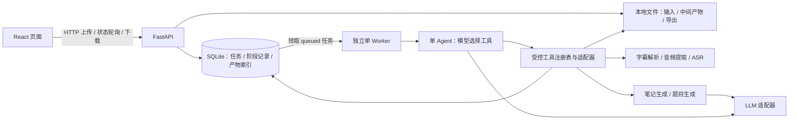

# VideoStudyAgent — MVP 规划

状态：阶段 1–3 已完成对应验证；用户已授权顺序执行阶段 2–7 并逐阶段提交上传。阶段 3 上传后接续阶段 4。用户选择 deepseek-flash，真实 LLM 验收按用户要求延后，先完成离线验证。

初稿日期：2026-10-12；修订日期：2026-10-13（Asia/Shanghai）。
本文件同时记录设计与阶段进度；仅阶段 1 标记的内容已实现，其余为待实现约定。具体依赖已在阶段 1 锁定，实测范围见 [阶段 1 验收记录](videostudyagent/docs/STAGE_1_REPORT.md)。

本版按用户要求优先采用已有开源模块。详细源码证据、固定提交和采用条目见 [GitHub 复用调研](videostudyagent/docs/REUSE_RESEARCH.md)。开发约束使用 Codex 可识别的 AGENTS.md 名称，不另建内容冲突的 agent.md。

## 1. 目标、范围与默认假设

用户上传本地课程 MP4、字幕，或两者，获得带来源时间戳的课程笔记及包含答案和解析的自测题；可查询任务状态、浏览结果和下载文件。

MVP 包含：本地文件上传；SRT/VTT 解析；本地语音转写；结构化 Markdown 笔记；可配置数量和难度的题目；单 Agent Tool Calling；React + FastAPI；任务和结果持久化；必要缓存；异常处理和自动化测试。

不包含：多 Agent、OCR、RAG/向量库、用户认证、视频链接抓取、在线编辑笔记、自动评分、PDF/Word 导出、生产部署。生成工具中的普通模型调用不是独立 Agent。

默认方案，用户可在确认规划时调整：

- 面向单机、单使用者本地运行；接口默认仅绑定 localhost。
- 输入允许 MP4 单独上传、SRT/VTT 单独上传、MP4 + 一份字幕。至少提供一种输入。
- 同时提供视频和字幕时，优先使用字幕，不再转写；字幕无效则明确失败，不静默改用语音识别。
- 题型先做简答题；数量默认 5，允许 1–20；难度 easy / medium / hard，默认 medium。输出语言默认简体中文，课程语言可自动识别或指定。
- 建议上限：视频 500 MiB / 120 分钟，字幕 5 MiB / 最大时间戳 120 分钟；均由配置控制。上限不是处理速度承诺，性能需在实际硬件测量。
- ASR 默认 faster-whisper small、多语言、CPU int8；模型和设备可配置，GPU 不是必需条件。模型文件预先准备或首次显式下载。
- LLM 通过一个支持原生 Tool Calling 的供应商适配器接入；不在规划阶段锁定供应商、付费模型和价格。阶段 1 使用 FakeLLM，真实适配器在阶段 4 接入。
- 导出 notes.md、quiz.md、quiz.json、transcript.json、transcript.srt。暂不提供打包下载。

## 2. 整体架构与技术理由

### 2.1 五个同类项目与采用优先级

调研已核查实际 LICENSE、完整 commit SHA 和关键源码，没有运行上游项目或纳入代码。复用顺序：成熟依赖包 → 可独立的小模块 → 去耦后的模块 → 有明确理由的最小本地实现。

| 项目 / 固定提交缩写 | 已核查许可证 | 计划复用模块 | 不能照搬的部分 |
| --- | --- | --- | --- |
| [BiliNote](https://github.com/JefferyHcool/BiliNote/tree/90940fde4d224d0f69ad99674f4af0a1ea52d3c4) / 90940fde4d22 | MIT | RequestChunker 直接复用；WhisperTranscriber、笔记提示、Markdown 渲染片段适配 | 分块默认计量是字节而非 token；转写会涉及 app/events、异常吞掉和自动清缓存；整页面依赖较广 |
| [DeepTutor](https://github.com/HKUDS/DeepTutor/tree/6cf793bd868ba5ecbe64722936d4be8fab5a01df) / 6cf793bd868b | Apache-2.0；需同时核对第三方通知 | JSON 解析小模块及测试直接复用；quiz 来源校验、必填工具参数检查适配 | 现有阅读 quiz 固定 3 道选择题；完整 loop/运行时依赖大；不引入多 Agent、RAG 或整个包 |
| [video-to-notes](https://github.com/Allen0497/video-to-notes/tree/3d9b2bdc45cc02fa5e53c2703456f4b7942f4678) / 3d9b2bdc45cc | MIT | 参考字幕优先策略；本地 ASR 调用作为精简备选 | 字幕和 ASR 的 TXT 输出丢失结束时间和毫秒；不采用下载、截图或 CLI 流程 |
| [AI Tutor](https://github.com/Milind1904/ai-tutor/tree/438e3aa42af58dcba61fa993dd1519ade55aafcc) / 438e3aa42af5 | MIT | 出题难度描述、QuizPanel 展示片段适配 | 出题链依赖 RAG/Groq，页面依赖会话和评分；不复用认证、向量库和自动评分 |
| [AI-Notes-Generator](https://github.com/SindhujaKumari211/AI-Notes-Generator/tree/bfbdcacae67577488dda8aa197619b3cd826b52f) / bfbdcacae675 | 未发现明确开源许可证 | 只参考高层分块/生成阶段设计 | 当前不复制其代码、提示、测试；不作为复用依赖 |

具体文件与完整 SHA 见 REUSE_RESEARCH.md。BiliNote 特指 JefferyHcool/BiliNote；采用已核查提交，不能根据同名项目或搜索摘要替换来源。DeepTutor 当前固定提交实际为 Apache-2.0。

### 2.2 复用后的架构决策

采用模块化单体：一个代码库，一个 FastAPI API 进程，一个独立 Python Worker 进程。两者共享本机 SQLite 和数据目录。Worker 是后台执行进程，不是第二个 Agent；它每次只处理一个课程任务。

优先组合 BiliNote 的转写/分块/笔记相关模块、DeepTutor 的结构解析/来源检查/参数保护小模块，以及 AI Tutor 的难度描述和自测展示片段。所有上游实现通过 adapter 转换为本项目契约；业务 API 和任务持久化不直接依赖上游内部类型。

必要自行实现部分为上传/状态/Worker、产物存储和缓存、数据映射、单 Agent 最小循环、下载导出。DeepTutor 完整运行时和各项目整站的依赖超过 MVP，因此不 fork 整站或整体安装。复用范围按源码耦合和测试结果调整，不按项目数或代码占比验收。



| 选择 | 用途与理由 | 边界 |
| --- | --- | --- |
| React + TypeScript + Vite | 单页学习界面；类型明确；前后端分离，适合上传、状态、笔记、自测交互 | 不需要 SSR、Next.js 或全局状态框架；先用组件状态和原生 fetch |
| Python + FastAPI + Pydantic | 复用 Python 音视频/AI 生态；统一请求、结果、工具参数校验，生成 OpenAPI | API 只负责请求、校验、持久化和查询，不执行长时间 ASR |
| SQLite + SQLAlchemy 2 + Alembic | 无需数据库服务；API 和 Worker 共用持久化状态；ORM 隔离存储并支持后续迁移 | 本机磁盘、WAL、短事务、busy timeout；SQLite 同时只允许一个写事务，不做分布式队列 |
| 独立单 Worker + SQLite 任务表 | 上传请求快速返回；API 重启不丢待执行任务；ASR 与 HTTP 响应隔离 | 暂不引入 Redis/Celery；领取用事务和状态条件更新，不宣称 exactly-once |
| FFprobe + FFmpeg | 验证容器、音轨和时长；统一提取 16 kHz 单声道 PCM WAV，便于缓存和测试 | faster-whisper 自身可用 PyAV 解码；此处显式选 FFmpeg 是为了统一媒体处理，不是它的强制依赖 |
| faster-whisper | 本地转写、保留片段时间戳；CPU 可运行；避免将视频发往语音云服务 | 不做说话人分离、强制对齐；字幕质量依赖录音和模型 |
| 一个 LLMClient 接口 + 一个真实适配器 | 支持原生 Tool Calling 和 JSON 生成；供应商可更换 | MVP 不接多个供应商，不上 Agent 框架；没有工具调用能力时明确报配置不兼容 |
| 小模块 vendor + 薄 adapter | 优先保留已核查开源实现和适用测试；将上游更新与本项目契约分离 | 不安装四个整站依赖；固定提交、登记改动并保留适用许可证/通知 |
| JSON 作为结果主格式，Markdown 作为展示/导出格式 | JSON 便于校验、来源追踪、前端自测；确定性模板输出 Markdown | 不从自由 Markdown 反向解析题目；LLM 不直接写文件 |
| pytest + HTTPX；Vitest + Testing Library；少量 Playwright | 分别验证业务/接口、页面交互、跨层主流程 | 默认离线，模型和网络替身；真实 ASR/LLM 冒烟单独运行并记录成本和环境 |
| 环境变量 + 本地 .env | 配置密钥、模型、限制和超时；Pydantic Settings 统一读取 | .env 忽略，.env.example 仅含空值/占位符；前端永远不持有 LLM 密钥 |

长期扩展点仅保留为接口：ASRProvider、LLMClient、TaskRepository、ArtifactStore。当前不实现第二套后端、分布式队列或多 Agent。

直接复用优先项：BiliNote RequestChunker 和 DeepTutor extract_json_object。ASR、提示、来源校验、工具参数守卫、页面片段采用改造式复用。上游缺少的严格题数/难度校验、毫秒映射、段落证据和任务恢复由本项目补齐。

## 3. 推荐目录

根目录现有 AGENTS.md 和 sources/ 是项目同步上下文，保持原样。videostudyagent/ 是实现目录；以下展示 MVP 推荐完整结构，阶段 1 只创建骨架与契约所需文件。

```text
项目镜像根目录/
├── AGENTS.md                     # 现有同步规则，保留
├── PLAN.md                       # 本规划与阶段进度
├── sources/                      # 只读参考资料
└── videostudyagent/               # 新开发内容
    ├── AGENTS.md                  # 后续实现约束
    ├── README.md                  # 本地配置、运行与验收指南
    ├── .env.example
    ├── .gitignore
    ├── THIRD_PARTY_NOTICES.md     # 实际纳入模块时创建，记录适用通知
    ├── third_party/licenses/     # 实际采用的上游许可证
    ├── backend/
    │   ├── pyproject.toml         # 依赖和工具配置；另配依赖锁文件
    │   ├── alembic/               # 数据库迁移
    │   ├── app/
    │   │   ├── main.py            # API 入口
    │   │   ├── worker.py          # 后台入口
    │   │   ├── api/               # 路由与 HTTP DTO
    │   │   ├── core/              # 配置、错误、脱敏日志
    │   │   ├── schemas/           # Pydantic 领域契约
    │   │   ├── db/                # ORM、会话、仓储
    │   │   ├── services/          # 上传、任务、缓存、产物、导出
    │   │   ├── agent/             # 单 Agent 循环、工具注册与调用记录
    │   │   ├── tools/             # 五个业务工具及其前置条件
    │   │   ├── providers/         # ASR / LLM 适配器与测试替身
    │   │   ├── adapters/          # 上游模块到本项目契约的映射
    │   │   ├── vendor/            # 按阶段纳入固定提交的小模块
    │   │   │   ├── bilinote/
    │   │   │   └── deeptutor/
    │   │   └── prompts/           # 有版本的系统提示与生成提示
    │   └── tests/                 # unit / integration / fixtures
    ├── frontend/
    │   ├── package.json           # 另配 package-lock.json
    │   ├── src/
    │   │   ├── pages/             # 上传与任务列表、学习结果
    │   │   ├── components/        # 进度、笔记、题目、下载
    │   │   ├── api/               # HTTP 客户端、OpenAPI 生成类型
    │   │   └── tests/
    │   └── e2e/
    ├── docs/
    │   ├── REUSE_RESEARCH.md       # 本轮已创建：五个项目调研
    │   ├── UPSTREAM_SOURCES.md     # 后续创建：实际引入文件/版本/哈希
    │   └── REUSE_DECISIONS.md      # 已创建：候选状态；采用/替换后追加证据
    └── data/                      # 忽略版本控制；由运行时创建
        ├── app.db
        ├── tasks/<task_id>/       # inputs / artifacts / exports / tmp
        ├── cache/<cache_key>/     # 可复用且校验通过的产物
        └── models/               # 本地 ASR 模型
```

阶段 1 已创建配置、Schema、健康接口、迁移骨架、测试替身、前端工作台、锁文件及指南；实际清单见 STAGE_1_REPORT.md。上图中的 Worker、上传、生成、vendor 等业务模块仍待对应阶段创建。third_party、vendor 和“实际引入”登记在实际采用时创建，不能将调研候选写成已接入模块。

## 4. 模块职责和数据流

| 模块 | 输入 → 输出 | 责任 |
| --- | --- | --- |
| API | multipart 文件 + options JSON → Task DTO | 输入规则、流式保存、创建任务、状态/结果/下载接口 |
| TaskService / Repository | 已验证输入描述 → Task、TaskStep | 状态迁移、原子领取、重试、时间与错误记录 |
| Worker | queued Task → 执行上下文 | 领取任务、调用单 Agent、持久化阶段完成和最终状态 |
| Agent runtime | TaskContext + 工具定义 → tool calls | 一个模型控制循环；依据合法前置条件选择工具；限制步骤和预算 |
| 字幕工具 | SRT/VTT → Transcript | 编码解析、时间规范化、片段排序、格式校验 |
| 音频工具 | MP4 → AudioArtifact | 验证音轨、提取统一音频、保留原始视频时间基准 |
| 转写工具 | AudioArtifact → Transcript | 本地 ASR，输出毫秒时间戳；可配置语言 |
| 笔记工具 | Transcript → NotesDocument | 分块、章节归纳、结构校验、来源关联 |
| 出题工具 | Transcript + NotesDocument + 固定 options → QuizDocument | 按数量/难度生成简答题、答案、解析及来源 |
| ArtifactStore / Cache | 已校验结果 → ArtifactRef | 文件原子落盘、摘要校验、缓存索引、Markdown/SRT 渲染 |
| Upstream adapters | 上游小模块输入/输出 → 本项目 DTO | 转写秒转毫秒、分块来源映射、结构化输出解析、来源及参数检查；不得暴露上游私有类型 |
| 前端 | Task / StudyResult → 交互页面 | 文件和参数提交、轮询、笔记展示、答案折叠、导出 |

外部和跨模块数据使用 JSON DTO / Pydantic 模型；媒体内容通过内部 ArtifactRef 传递，不把二进制或完整字幕塞进 Agent 历史。ArtifactRef 的 storage_key 仅在服务端使用，HTTP DTO 不暴露绝对路径。

执行流程：

1. 浏览器提交文件和参数；API 流式写入任务临时目录，限制大小、检查扩展名/文件内容、计算 SHA-256。媒体/字幕完整校验由工具完成，失败会反映到任务状态。
2. 输入文件就位后以短事务创建 queued 任务；返回 HTTP 202 + task_id。客户端每 2 秒轮询，终态停止，网络错误退避；上传错误在创建任务前直接返回 4xx。
3. 单 Worker 事务领取 queued 任务并置为 running，创建运行上下文，启动唯一 Agent 控制循环。
4. 有字幕：load_subtitles。无字幕：extract_audio → transcribe_audio。视频与字幕同时存在时验证字幕时间不超过视频时长加可配置容差。
5. generate_notes → generate_quiz。每一步输出先校验、原子写入，再记录 Artifact 和 TaskStep；后续步骤使用已验证结果。
6. Agent 返回结束消息后，Worker 独立核对 Transcript、Notes、Quiz 的存在性、版本、来源与请求参数；全部满足才标记 succeeded。模型说“完成”不能改变状态。
7. 前端展示课程笔记与自测题；导出由确定性渲染器提供，下载不再次调用 LLM。

长课程优先通过 BiliNote RequestChunker 的外围适配器分块，注入模型适配的 token 计量，另保留实际请求字节上限。预算包含系统提示、工具定义、输入和预留输出。保留全局 segment_id 和时间戳；拆分超长片段使用内部 part_index，不修改规范 Transcript，不为子片段推测新时间。

每块生成带来源的章节材料，再汇总成笔记。出题根据各章节材料分配数量，附带相关原字幕片段，复用并适配 DeepTutor 的原文证据校验。不得照搬其 6000 字符上下文截断或固定 3 题限制，不静默丢弃后半课程。该机制只处理当前课程，不建立检索库或 RAG。

## 5. 核心数据模型

以下契约已在阶段 1 建立对应 DTO，持久化表和业务行为仍待实现。外层请求/结果文档带 schema_version，嵌套值对象随外层版本；ID 使用 UUID 字符串，segment_id 在一份 Transcript 内稳定；时间戳使用相对原视频的整数毫秒，审计时间使用带时区 ISO 8601，业务写入统一 UTC。跨文档原文匹配、来源存在性与状态转换由对应阶段的业务服务验证。

| 模型 | 核心字段 | 约束 / 保存方式 |
| --- | --- | --- |
| StudyOptions | question_count、difficulty、question_type、output_language、transcript_language | 1–20；easy/medium/hard；仅 short_answer；创建后不可变 |
| InputAsset | id、task_id、kind、original_name、storage_key、sha256、size_bytes、duration_ms? | kind=video/subtitle；原文件名仅用于展示，内部路径由服务端生成；assets 表 |
| Task | id、title、options、status、current_step、attempt、created_at、started_at?、finished_at?、error? | queued/running/succeeded/failed；重试次数与阶段分开；tasks 表 |
| TaskStep | id、task_id、attempt、tool_name、status、cache_key?、artifact_id?、started_at?、finished_at?、error? | pending/running/succeeded/failed/skipped；task_steps 表；提供有依据的进度，不虚报 ASR 百分比 |
| Transcript | schema_version、source、language、duration_ms、segments | source=subtitle/asr；文件 JSON，索引入 artifacts 表 |
| TranscriptSegment | id、start_ms、end_ms、text | start>=0；end>start；按 start 排序；非空文本；允许合法重叠；不编造缺失时间戳 |
| TranscriptChunk（内部） | id、source_segment_ids、parts、token_estimate、content_hash | parts 记录 segment_id/text/part_index；保留原片段映射，不能写回 canonical Transcript |
| NotesDocument | schema_version、title、learning_objectives、chapters、key_concepts、summary | 章节含 id、title、content_markdown、source_segment_ids；来源必须存在；JSON 主格式，生成 notes.md |
| QuizDocument | schema_version、question_count、difficulty、questions | questions 长度必须与请求一致，难度与请求一致；JSON 主格式 |
| Question | id、type、difficulty、chapter_id、question、answer、explanation、source_segment_ids、evidence | 简答题；题目/答案/解析非空；chapter_id 和片段引用有效；evidence 含 segment_id/quote，原文必须存在；明显重复题拒绝或有限补生成 |
| Artifact | id、task_id、kind、schema_version、storage_key、sha256、cache_key?、created_at | artifacts 表记录文件元数据；kind=audio/transcript/notes/quiz |
| CacheEntry | key、kind、storage_key、sha256、schema_version、created_at | cache_entries 表；仅索引校验通过的不可变文件，不关联临时路径 |
| ErrorInfo | code、message、step、retryable | 统一用于 HTTP 错误、Task、TaskStep；不包含密钥、绝对路径或供应商原始响应 |
| ToolCallRecord | task_id、attempt、sequence、tool_name、status、artifact_id?、duration_ms、usage? | 可并入 task_steps；只存必要元数据，不存思维链、完整提示或模型原始异常 |

关系：Task 1:N InputAsset、TaskStep、Artifact；Transcript、Notes、Quiz 保存为版本化 JSON，数据库不重复存大段全文。HTTP 返回的 StudyResult 聚合 task_id、available_artifacts、transcript?、notes?、quiz?；失败任务可以读取已完成产物，缺失部分为 null，不能显示为全部完成。

Transcript 示例（仅说明格式）：

```json
{
  "schema_version": "1.0",
  "source": "subtitle",
  "language": "zh",
  "duration_ms": 18000,
  "segments": [
    {"id": "seg_0001", "start_ms": 0, "end_ms": 6500, "text": "本节介绍梯度下降的基本思想。"},
    {"id": "seg_0002", "start_ms": 7000, "end_ms": 18000, "text": "学习率控制每次参数更新的步长。"}
  ]
}
```

笔记和题目引用 source_segment_ids，时间范围由后端根据原片段计算；前端展示如 00:00–00:06，避免让模型自由编造来源时间。字幕单独上传时 duration_ms 取最大 end_ms，不声称等于视频真实时长。

出题来源检查强化为：evidence 中每个 quote 必须出现在对应原始 segment.text 内，引用集合与 source_segment_ids 一致；只允许保守空白/大小写归一化，保留负号、数字、公式和标点含义。证据保存到 Quiz JSON 并随 JSON 导出，方便抽查。原文存在不等于答案语义正确，最终验收仍做课程内容抽查。上游秒数、TXT、三题选择题等模型不能直接成为本项目 API 契约。

## 6. API 契约

| 接口 | 请求 / 返回 | 行为 |
| --- | --- | --- |
| GET /api/health | 健康状态 | 阶段 1 起可测；不调用付费模型或下载 ASR 权重 |
| POST /api/tasks | multipart：video?、subtitle?、options JSON、title? → 202 Task | 至少一个文件；每类最多一个；参数错误 422，过大 413，不支持类型 415 |
| GET /api/tasks?limit=&offset= | Task 摘要列表 | 按创建时间倒序；分页，上限固定 |
| GET /api/tasks/{id} | Task + TaskStep 摘要 | 包括当前步骤、可重试错误、可用产物；未知 ID 404 |
| GET /api/tasks/{id}/result | StudyResult | 部分结果可读；成功结果结构相同；不暴露存储路径 |
| POST /api/tasks/{id}/retry | 202 Task | 仅允许 failed 且 retryable；running/queued 返回 409；清除错误、attempt+1、回到 queued |
| GET /api/tasks/{id}/exports/{format} | 下载文件 | format 为固定枚举；未完成对应产物返回 409；未知格式 404 |

下载格式固定映射到 notes.md / quiz.md / quiz.json / transcript.json / transcript.srt；不接受客户端文件路径。HTTP 错误体统一为 {"error":{"code":"...","message":"...","step":null,"retryable":false}}。

阶段 1 确定 DTO 和 OpenAPI，后续修改契约需同步文档与前端类型。结构校验统一通过 Pydantic，LLM 输出同样接受校验，不能绕过。

## 7. 单 Agent 与工具调用约束

一个 Agent 根据模型返回的原生 tool calls 决定下一步；业务工具是普通可单测函数。以下括号表示工具绑定的输入输出关系，实际调用只允许受控的参数 Schema：

| 工具 | 输入 → 输出 | 前置条件 |
| --- | --- | --- |
| load_subtitles | 当前任务字幕 → TranscriptRef | 有上传字幕；不得跨任务访问 |
| extract_audio | 当前任务视频 → AudioRef | 没有上传字幕；MP4 可解码且有音轨 |
| transcribe_audio | 当前任务 AudioRef → TranscriptRef | 已成功提取音频 |
| generate_notes | 当前任务 TranscriptRef → NotesRef | Transcript 校验成功 |
| generate_quiz | 当前任务 TranscriptRef + NotesRef → QuizRef | Notes 校验成功；数量/难度从不可变 StudyOptions 注入 |

Agent 不是一串伪装成 Agent 的固定函数调用：控制循环会接收工具定义、模型 tool calls 和工具回执，并继续请求模型决策。服务端只限定合法动作和完成条件；不允许跳过前置条件、改写用户选项或由模型宣称成功。

- 工具绑定服务端 TaskContext；模型不能提供任意路径、URL、shell 命令或其他 task_id。参数由 Pydantic 校验，未知工具拒绝执行。
- 回执统一为 ok、artifact_id、summary、cache_hit、error；不把完整课程正文反复回传给调度模型。生成工具自行按预算读取片段。
- 默认每次 attempt 最多 12 次工具调用；无进展重复最多 2 次；同时限制累计模型请求次数、输入/输出 token 和整任务时长。具体预算配置化，阶段 4/5 用选定模型实测。
- 不开放并行工具调用；模型同一轮返回多个调用时按顺序验证并执行，每个动作执行后重新检查前置条件。
- 相同步骤重复调用幂等返回已校验产物；非法参数/未知工具可返回一次纠正提示，再失败；不能无限循环。
- 生成工具内部的分块归纳、JSON 修复是有界函数流程，复用同一个 LLMClient，不创建自主 Agent。
- 字幕和模型生成文本作为课程数据处理，不允许改变系统指令或工具权限。

工具参数优先适配 DeepTutor tool_arg_guard 的必填检查/纠错信息，随后执行本项目 Pydantic 完整校验、工具白名单和 TaskContext 归属检查。当前不引入其 label 驱动完整 runtime、StreamBus、subagent 或 RAG 工具；最小循环只承载本项目五个工具。

## 8. 持久化、缓存、恢复与错误策略

任务状态：queued → running → succeeded / failed。用户显式重试：failed → queued（attempt+1）。current_step 表示实际执行阶段，不增加大量任务状态。阶段完成逐步落盘，失败保留已验证产物。

- SQLite 使用 WAL、短事务和有限忙等待；长时间 FFmpeg、ASR、LLM 调用不持有数据库事务。
- MVP 只允许一个 Worker；进程启动获取系统释放型独占锁，第二实例明确退出。阶段 1 选型 filelock 原生 WindowsFileLock / UnixFileLock，不静默退回 SoftFileLock，非阻塞获取、全程持有；阶段 5 才安装、实现并验证双进程互斥/崩溃恢复。
- 只有在 Worker 获得独占锁后才恢复遗留 running 任务：将其标记 failed / WORKER_INTERRUPTED / retryable=true；保留 queued 任务。API 启动不擅自改写 running。
- 中断任务不自动重新发起可能收费的模型请求；用户选择重试后复用已完成步骤。进行中模型调用可能已被供应商计费，这不保证避免重复费用。
- 文件先写任务临时文件，再同卷原子替换；成功后提交产物索引。崩溃可能留下未索引文件，后续识别为孤立产物；不复用半写入文件，不承诺文件与数据库跨介质原子事务。
- 缓存键使用规范化参数和内容哈希：音频=视频 hash + 提取配置/版本；转写=音频 hash + ASR 模型标识/权重版本 + 语言/参数 + Schema/工具版本；字幕=字幕 hash + 解析版本；笔记=Transcript hash + 语言 + 供应商/模型/生成参数 + Prompt/Schema/工具版本；题目额外加入 Notes hash、题数、难度和题型。
- 缓存不包含 API Key；缓存文件独立保存、摘要校验，损坏则失效重算。只在首次生成时验证通过的结果可入缓存；不复用失败状态。
- 网络超时、429、可恢复 5xx：单次模型请求最多额外重试 2 次，指数退避并遵守 Retry-After；仍计入 attempt 请求/时间预算。401/403、格式不支持、无音轨不做自动重试。
- 输出 Schema 不合法、题数不符：最多一次修复或补齐；仍不合格则 GENERATION_INVALID，不把伪完整结果标成成功。
- 优先用 DeepTutor extract_json_object 解析常见包裹 JSON，再做严格 Schema 校验；空字典、缺答案、缺解析、错误难度、虚假来源同样失败，不能沿用上游宽松默认或静默降级。
- 超时区分媒体探测、转码、ASR、LLM、整任务，均可配置；ASR 在可终止的子进程执行，Worker 控制超时；不让模型超时重试导致无限成本。
- 所有异常落为稳定错误码和用户可理解的信息；日志只记录 task_id、attempt、步骤、耗时、错误码、必要模型标识/用量。不记录密钥、Authorization、完整环境变量、字幕全文或原始请求响应。

主要错误码：UPLOAD_TOO_LARGE、UNSUPPORTED_MEDIA、INVALID_SUBTITLE、NO_AUDIO_TRACK、EMPTY_TRANSCRIPT、ASR_UNAVAILABLE、ASR_TIMEOUT、LLM_CONFIGURATION_ERROR、LLM_TIMEOUT、LLM_RATE_LIMIT、GENERATION_INVALID、AGENT_LIMIT_EXCEEDED、WORKER_INTERRUPTED、STORAGE_ERROR。

无认证的 MVP 只面向本地使用。上传文件名不能影响写入位置，文件/导出访问校验归属；Markdown 禁用原始 HTML，链接协议白名单，字幕文本不能触发脚本。真实 LLM 默认仅接收字幕文本和生成材料，视频/音频保留本机；完整离线学习依赖后续选择可本地运行且支持 Tool Calling 的模型，不作为默认承诺。

### 上游模块采用门槛

- 取得明确许可证、固定 SHA 和来源路径后才能纳入；保留版权、许可证及适用第三方通知，记录修改。AI-Notes-Generator 当前只有设计参考资格。
- 先保留独立 vendor 模块；业务调用只经过 adapter。改动较大的 ASR/提示/前端片段在适配文件中写明来源及改动，不伪称原样复用。
- 不执行上游安装脚本或 Agent 指令，不自动启动整站；不引入登录、向量数据库、整套 deeptutor、截图或自动评分依赖。
- 去除/替换 BiliNote 的自动目录删除、隐式模型重下载、异常打印并吞掉等与本项目约定冲突的行为。模型文件准备显式化。
- 本项目默认测试离线；复用 upstream 适用测试并补时间、证据、预算、跨平台和错误边界。上游 README 的测试和速度数据不是本项目证据。
- 若模块不能满足约束，先查清单内备选/成熟库，最后才最小自研；记录具体阻碍及替代，不为凑复用比例增加系统复杂度。

## 9. 分阶段开发与验收

每次只处理一个阶段，完成对应测试、报告和 GitHub 上传后，按用户本次授权继续下一阶段。测试不通过时先修复本阶段。真实服务不可用时分别记录离线测试通过情况和真实验证缺口，继续不依赖它的工作，不能声称真实验收通过。不执行部署。

| 阶段 | 独立交付与范围 | 对应测试 | 验收标准 |
| --- | --- | --- | --- |
| 0：调研与规划（已完成） | 本 PLAN.md、新项目 AGENTS.md、REUSE_RESEARCH.md；核查五个项目的源码/许可证；不编写业务代码 | 文档完整性、固定提交与来源 URL、只读边界检查 | 对每个候选明确直接复用/适配/参考/不采用及理由；用户确认后才进入 1 |
| 1：复用基线、工程骨架与契约（已完成） | 将调研条目登记为候选/待验收，核对运行环境与依赖；后端/前端最小骨架、配置、DTO、health、迁移骨架、测试替身、锁文件、README | 后端 63 项、前端 7 项通过；typecheck + build、临时 SQLite、候选登记及契约同步通过；见验收记录 | 无密钥可启动和测试；health 不联网；题数/难度/时间戳非法输入被拒；页面壳可打开；明确各模块采用阶段；不提前实现上传、ASR、生成业务 |
| 2：输入与持久化（已完成） | 上传、文件验证边界、Task/Asset/Step/Artifact 表和迁移、任务列表/详情、原子领取和重试仓储操作 | 后端 80 项、前端 7 项通过，类型/构建通过；见 STAGE_2_REPORT.md | 上传流式处理并创建 queued；重启 API 后任务和输入可读；重复领取仅一个成功；尚不启动业务 Agent |
| 3：复用转写、补齐字幕契约 | 优先适配 B2 WhisperTranscriber；SRT/VTT、媒体探测/提取、Transcript、缓存；B2 不合适时评估 V1 精简调用 | 上游适用转写断言 + 本项目解析/秒转毫秒/语言/无音轨/无语音/错误传播/超时；FFmpeg 集成；真实短音频冒烟 | 不采用有损 TXT 字幕输出；无自动删除用户目录或隐式下载；字幕优先；缓存有效；B2/V1 采用或替换理由有记录 |
| 4：复用分块、结构解析和出题依据 | B1 RequestChunker、B3 笔记提示、D1 JSON 辅助函数、D2 来源校验、T1 难度描述；首个真实 LLM 适配器、输出/缓存 | 迁移适用 upstream 单测；FakeLLM 覆盖中英文长字幕、token/字节预算、来源映射、负号/公式、严格题数/解析/难度、有限修复；真实 LLM 冒烟 | 至少 B1/D1 复用落地或有可验证阻碍和替代记录；恰好 N 题，答案解析和原文证据齐全；全课覆盖；许可证/来源登记完整 |
| 5：适配参数保护、集成单 Agent | D3 必填参数守卫适配、五工具原生 Tool Calling 循环、Worker、状态/恢复/调用记录与预算 | 上游适用必填参数断言 + Pydantic 完整校验；未知工具/越权/重复/超限/过早结束/重启/超时；双输入路径 | 不安装 DeepTutor 整包或多 Agent 运行时；工具确由模型驱动；API 可响应；中断可重试；产物齐全才成功 |
| 6：适配 Web 展示与导出 | 评估 B4 Markdown 渲染片段、T2 自测展示片段；上传、状态、结果、重试、答案折叠、下载 | 组件及受控 props 测试；禁止残留 session/auth/评分/RAG 请求；下载一致性；Playwright 主流程；XSS/路径测试 | 上游 UI 只保留适用渲染逻辑；不新增自动评分；页面完成学习闭环；导出不生成；B4/T2 采用或替换理由记录 |
| 7：MVP 与复用综合验收 | 真实小样本端到端、故障回归、临时文件清理、指南；核对所有实际引入模块 | 全量既有测试、类型/构建、E2E；真实 MP4/字幕；重启/缓存损坏/敏感信息；来源/哈希/许可证/通知检查 | MVP 清单有证据；候选不冒充已采用；无未明确授权来源代码；真实验证缺口明确；不部署、不提交 Git |

阶段依赖：1 → 2 → 3 → 4 → 5 → 6 → 7。阶段 3/4 的工具可直接单测，无需先实现 Agent；阶段 5 再接入调度，避免同时调试内容生成与任务编排。

每阶段报告固定包含：完成范围、修改文件、采用的上游条目 ID/版本/改动、未采用及替代原因、实际运行测试与结果、未运行项目及原因、遗留问题、下一阶段内容。不自行提交、推送、部署。

### MVP 最终验收清单

- [ ] MP4 单独上传，产生带时间戳的 Transcript、笔记、自测题。
- [ ] SRT/VTT 单独上传和视频配字幕均可处理；配字幕路径没有 ASR 调用。
- [ ] 1、5、20 题边界和三个难度满足结构/参数校验；题目、答案、解析齐全。
- [ ] 长课程处理包括后半内容，片段引用和时间映射可追溯；不虚构来源。
- [ ] 单 Agent 的合法工具调用、错误纠正、预算限制可通过测试记录验证。
- [ ] 任务、步骤、产物重启后存在；中断任务显示可重试；已完成步骤可复用。
- [ ] 五种导出可下载、内容与校验结果一致；Markdown 安全展示。
- [ ] 上传错误、无音轨、无语音、ASR/LLM 超时、输出非法、缓存损坏有明确行为。
- [ ] 默认测试不依赖密钥/外网；真实 ASR/LLM 验证单独记录；密钥不进入代码、响应和日志。
- [ ] 真实课程抽查：核心概念/公式没有明显误写，每道题的答案和解析可由所引片段支持；结构校验不替代语义抽查。
- [ ] 复用条目有固定 SHA、原始路径、纳入文件 hash、许可证/通知、修改和测试记录；未采用理由可追溯。
- [ ] 不存在上游 RAG/登录/自动评分/多 Agent 隐式运行依赖；AI-Notes-Generator 未授权代码、提示和测试未纳入。
- [ ] B1/D1 等优先小模块有实际采用证据或明确替代原因；不通过复制空模块、增加大依赖或降低契约要求凑复用数量。

## 10. 当前记录与待定项

阶段 1 已完成：五项目/11 条候选的机器可验证基线、前后端工程骨架、环境配置、版本化 DTO/OpenAPI/前端类型、健康接口、SQLite 空基线迁移、FakeLLM/FakeASR、离线测试、依赖锁及 README。测试 63 + 7 项通过；本地浏览器确认服务连接。详见 [验收记录](videostudyagent/docs/STAGE_1_REPORT.md)。

当前没有上游业务源码纳入，没有业务表/上传/ASR/生成/Worker，没有下载模型或调用 LLM。阶段 1 迁移测试只使用临时库，健康服务不创建默认数据目录。阶段 2 等待用户授权；到阶段 4 真实接入前必须确定一个支持 Tool Calling 的服务及调用预算。明确许可证的候选模块按授权阶段直接评估采用，不逐模块重复请求确认；不明确授权的来源仅参考，不阻塞其他阶段。默认项按第 1 节执行。

## 11. 技术依据

以下仅为官方资料依据，架构中的单 Worker、阶段和业务限制为本项目设计选择：

- 五个同类项目的固定提交、许可证原文、具体文件和复用限制：[REUSE_RESEARCH.md](videostudyagent/docs/REUSE_RESEARCH.md)。

- React 单页项目及 Vite/TypeScript：[Build a React app from Scratch](https://react.dev/learn/build-a-react-app-from-scratch)。
- FastAPI 的类型校验和 OpenAPI：[FastAPI](https://fastapi.tiangolo.com/)；重计算与轻量后台任务的区别：[Background Tasks](https://fastapi.tiangolo.com/tutorial/background-tasks/)。
- Pydantic 数据模型：[Models](https://pydantic.dev/docs/validation/latest/concepts/models/)。
- SQLite WAL 支持读写并发但仍只有一个写入者，且面向同机文件系统：[Write-Ahead Logging](https://www.sqlite.org/wal.html)。
- filelock 原生平台锁及释放行为：[filelock 官方文档](https://py-filelock.readthedocs.io/en/latest/)；选型已完成，双进程与恢复实测在阶段 5。
- faster-whisper 的 CPU int8、片段/词级时间戳、模型加载与 PyAV 说明：[官方仓库](https://github.com/SYSTRAN/faster-whisper)。
- FFmpeg 媒体处理能力：[ffmpeg Documentation](https://ffmpeg.org/ffmpeg.html)。
