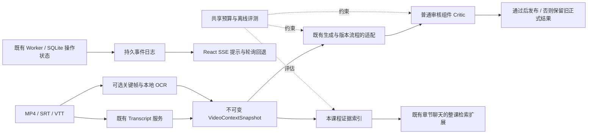

# VideoStudyAgent V3：阶段 15–19 实施路线与验收状态

原规划日期：2026-10-14。2026-10-15 最新状态：**阶段 15、16、17、18A、19 已完成离线实现和验收**。实际证据见 STAGE_15_REPORT.md 至 STAGE_19_REPORT.md；最终后端 302 项、前端 22 项、E2E 5 项通过。18B 向量模型为条件项，未启用；真实 OCR/LLM/长课程质量未验证。以下保留原始设计目标，完成情况以阶段报告为准。

基线：84251227a61cfc6f05167a88c000146f3e8fd737。参考输入为用户下载版 VideoStudyAgent_Codex_Roadmap_v3.md，源码研究固定 DOVideo-AI 的 df4fa83a78a51dfa1718606bf47cf49942e1112e。实际功能证据及上游链接见 [差距审计](GAP_AUDIT_V3.md)，约束变更草案见 [AGENTS 草案](AGENTS_V3_DRAFT.md)。V3 是产品迭代名称，不意味着把所有 JSON 文档版本直接改为 3.0。

## 1. 架构与扩展边界

保留 FastAPI + React/TypeScript + SQLite + 本地文件 + 独立单 Worker + 唯一 StudyAgent。沿用原生 Tool Calling、工具权限保护、供应商适配器、BoundedLLM、全字幕分块、NoteCheckpoints、不可变版本、幂等/CAS、固定 5 题和聊天记录。

扩展关系：

评测工具是显式运行的开发工具，不是用户上传后的新 Agent。Critic 是普通服务函数和可选模型调用，不拥有独立规划循环。SSE 只传递状态提示，API 不执行 OCR、ASR、生成、索引构建等耗时工作。

不搬入 Java/Spring、Redis、RocketMQ、MySQL、MinIO、Qdrant 或上游整站。暂不做认证、公开部署、跨课程知识库、自动评分、断点上传、内容创作/审查产品模式。没有真实需求前不增加基础设施。

## 2. 顺序、依赖及确认门槛

| 阶段 | 目标 | 硬依赖 | 完成后可单独验收 |
| --- | --- | --- | --- |
| 15 | 审计与离线评测基线 | 当前 V2；本次审计已完成，评测器尚待授权 | 合成/授权数据与指标，零云端请求 |
| 16 | 可选 OCR 和带来源的 VideoContext | 15；确认 OCR/截图约束例外 | 视觉与字幕独立、单路降级、OCR-only、旧资料兼容 |
| 17 | Evidence-aware Critic、最多一次定向重做 | 15、16；先按 ID/时间取证，不依赖 18 | 正式发布前审核、失败保留旧结果、预算内有限修复 |
| 18 | 时间戳证据检索与跨章节问答 | 15、16、既有聊天；复用 17 的反馈接口 | 本地词法检索先交付；向量混合按实测价值另设门槛 |
| 19 | SSE 与学习工作台 | 既有操作仓储及 16–18 的阶段状态 | 持久游标、断线恢复、轮询回退 |

每阶段独立实现、测试和报告。用户已授权完成阶段 15–19 的本地 OCR/单课程检索范围，随后授权最终统一提交 GitHub。没有付费调用、个人库升级、部署或向量模型下载授权；这些边界保持有效。

## 3. 阶段 15：最小可实施任务

### 15.1 目标与非运行时边界

建立可重复、可解释的评估基线，先区分程序契约与学习内容质量。本次已有 GAP_AUDIT_V3.md、ROADMAP_V3.md、AGENTS_V3_DRAFT.md；它们不代表阶段 15 的评测器已经实现。

确认后最小范围仅为独立 evaluation 目录、少量自建 JSON 用例、报告模板和评测器测试。不修改 app/、生产 API/Worker、前端业务流程、数据库 schema、预算或上游采用登记；不安装新依赖，不执行真实模型，不准备大型视频/模型。

### 15.2 拟新增/修改文件

| 拟新增文件 | 职责与依赖 |
| --- | --- |
| backend/evaluation/__init__.py、contracts.py | 评估用例、指标、运行清单；使用现有 Pydantic，不混入生产 DTO |
| backend/evaluation/metrics.py | 调用既有 Schema 和 grounding 校验，计算分子/分母；不重写 quote_present |
| backend/evaluation/run.py | 仅 fixture/replay 两种模式；明确输入目录和输出目录；不读取 Settings()、个人 DB 或 .env；live 模式不提供入口 |
| backend/evaluation/cases/v1/*.json | 至少 12 个自建/获授权的小用例、散列、参考来源与预期断言；不复制上游四条黄金案例作本项目质量证据 |
| backend/tests/test_evaluation.py | 指标、无样本、无网、错误输入、可重复性和报告隔离测试 |
| docs/EVALUATION_V3_SPEC.md、docs/STAGE_15_REPORT.md | 评分规范、已执行/未执行分项与实际结果 |
| docs/GAP_AUDIT_V3.md、docs/ROADMAP_V3.md | 仅在验收后更新阶段 15 状态与真实证据 |

运行结果默认写忽略目录 .cache/evaluation/，不保存密钥、完整模型提示或用户课程全文到日志。报告若含课程内容，只能留在显式本地输出目录，不自动上传。

### 15.3 评测数据契约

| 模型 | 必需字段 | 约束 |
| --- | --- | --- |
| EvaluationCase | case_id、suite_version、scenario、provenance、input_sha256、fixture_refs、capabilities_required、expected_assertions、reference_fact_ids | provenance 标明自建/授权及允许用途；路径限定在用例目录；引用稳定源 ID，图像/OCR仅作参考标注，不调用尚未实现的 OCR |
| EvaluationRun | run_id、project_git_sha、suite_sha256、mode、capabilities、模型/提示/非敏感配置版本、started_at、case_results | mode=fixture/replay；不含 Key，不调用默认生产仓储；未获授权不能切换 live |
| MetricResult | name、value、numerator、denominator、status、measurement_scope、reason | value 可为 null；status=measured/not_run/not_applicable/insufficient_data；分母 0 不返回 0% 或 100% |
| CaseResult | case_id、execution_status、assertions、metrics、missing_capabilities、error_code | 未实现 OCR/检索明确 pending_capability；报告执行数、待执行数和失败数，不能通过排除用例虚增成功率 |

### 15.4 指标定义

| 指标 | 分子/分母及边界 |
| --- | --- |
| schema_valid_rate | 通过对应既有 Pydantic 契约的候选数 / 已评估候选数；故意无效负例应降低指标，但评测器自身应正确判错 |
| quote_match_rate | 模态、快照、源 ID 正确且原文匹配的引用数 / 已评估引用数；OCR 将来只能证明与识别文本一致，不能证明像素识别正确 |
| source_id_coverage_rate | 被引用的独立字幕源 ID 数 / 期望字幕源 ID 数；不命名为知识完整率 |
| timestamp_valid_rate | 能回溯到真实源时间的证据数 / 已评估时间证据数；不命名为视频内容覆盖率 |
| claim_faithfulness_manual | 人工按具体事实与证据标注的忠实结论数 / 已人工复核结论数；本次真实模型值为 null、not_run |
| note_coverage_manual | 已正确表达的参考知识点数 / 已人工复核的应覆盖知识点数；不能以“关键词出现”代替正确表达 |
| quiz_answer_correctness_manual | 经人工确认可由指定证据回答且答案正确的题数 / 已复核题数 |
| performance / usage | 墙钟耗时、阶段耗时、预留请求/token、供应商已报告用量及完整度；fixture 运行耗时不等于真实模型延迟；费用无账单时为 null |

合成输出的 expected_assertions 用来验证评测器会发现错误，不作为 deepseek-flash 准确率。尚未人工复核的语义指标始终未验证。后续真实调用的 provider/model/日期/调用量单独记录，需要届时另行确认费用上限。

### 15.5 最小用例与验收

至少涵盖：纯语音事实/负号、字幕毫秒与重叠、有效引用但答案错误、ID 全覆盖但知识遗漏、PPT 文字、板书/代码/公式、音画冲突、静音纯画面、跨课程伪引用、长字幕末尾、OCR 不可用、提示注入。视觉类先提供自建标注与预期，不把尚未执行的 OCR 功能算通过。

验收要求：

1. 新评测器对预置的有效/无效结构及引用断言判定一致率 100%；故意错误答案不能只凭 quote_match 判为语义正确。
2. fixture 模式零外网、零供应商请求、零个人 DB 访问；即使用户已有 Key 也不能隐式启用模型。
3. 缺少样本、缺少能力、缺少人工评审分别输出明确状态及 null，不虚构准确率或费用。
4. 同一基线、数据和参数的确定性指标一致；run_id、时间、耗时不要求字节相同；非法路径、散列不符、未知版本明确失败。
5. 当前全部后端/前端测试不退化，类型检查通过；报告明确新的用例与历史测试分别证明什么。无需启动生产服务、迁移个人库或执行新增 E2E。

未来复现命令：backend 中运行 .venv/Scripts/python.exe -m evaluation.run --mode fixture --suite evaluation/cases/v1 --output ../.cache/evaluation/latest；再运行 python -m pytest -q。前端运行 npm test 和 npm run typecheck。evaluation.run 目前尚不存在，这些是阶段 15 拟实现的入口。

## 4. 阶段 16：OCR 与 VideoContext

### 16.1 范围与理由

用户显式启用 OCR，默认关闭；有字幕仍优先用字幕代替 ASR，视觉分支可按需同时运行。Worker 内先采用有界顺序子步骤，复用既有媒体进程超时/取消；只有评测证明收益后才采用有界 ASR/OCR 并行，不引入第二 Worker 或 Agent。

复用现有 FFmpeg 媒体接口抽帧；场景变化 + 最大采样间隔策略参考上游，初始候选 30 秒，阈值与帧数/分辨率/总时限需本地小样本确认，不修改用户现有预算。使用真实输出 PTS，并记录时间基准；时间缺失的帧不能按序号推时刻，作为视觉分支异常降级或失败。

OCR 候选为本地 Tesseract CLI，stdout/stderr 分离，TSV 返回原文/bbox/置信度；只在阶段 16 授权后评估 Pillow/图像哈希可选依赖，固定版本与许可。官方 [Tesseract TSV](https://tesseract-ocr.github.io/tessdoc/Command-Line-Usage.html#tsv-output) 支持这些字段。dHash 仅识别重复候选；精确图像散列可复用 OCR，近似画面不能未经验证跳过数字/公式变化。

### 16.2 新数据契约和文件落点

| 新模型 | 关键字段与持久化 |
| --- | --- |
| EvidenceFrame | id、task_id、video_asset_sha256、timestamp_ms、文件 SHA/存储键、尺寸、提取参数版本；帧是一个观察时刻，不宣称整分钟都显示同一内容 |
| OcrObservation | id、frame_id、raw_text、bbox、confidence?、engine_version、language、status、error_code?；原文与归一化文本分开，不去掉负号/数学符号 |
| VideoContextSegment | id、start_ms、end_ms、transcript_segment_ids、ocr_observation_ids、frame_ids、source_types；时间窗口只做组织，不修改原字幕区间 |
| VideoContextSnapshot | id、task_id、video_asset_id?、transcript_snapshot_id?、segments、ASR/字幕/OCR 分支状态、warnings、manifest_sha256、提取配置版本 |
| EvidenceRef | task_id、snapshot_id、source_type=transcript/ocr、source_id、quote；OCR 指向 observation/frame 的真实时刻，字幕指向原始片段 |
| Notes/Quiz 1.2 与对应版本记录 | 多来源 source_refs、context_snapshot_id；旧 1.0/1.1 只读兼容；新题仍严格 5 道，无笔记章节仍可为空 |
| ConversationMessage 1.2 | 沿用既有会话、顺序、幂等与 notes_revision_id，citations 扩展为多来源 EvidenceRef；1.1 消息仍按旧契约读取 |

来源 ID 按任务/输入散列、真实 PTS、提取版本和原始内容稳定构造；VideoContext 不包含用户目标，目标仍属于 operation.request，避免不同问题重复 OCR。缓存键额外包含上下文散列、模态选项和 OCR/抽帧版本，不含密钥。

拟新增：app/schemas/video_context.py、providers/ocr.py、services/vision.py、services/video_context.py、services/source_context.py、db/context_repository.py、db/context_models.py、alembic/versions/0004_video_context.py、routes/evidence.py、frontend/src/components/ContextEvidence.tsx、tests/test_video_context.py、test_ocr.py。

最小修改：services/media.py 复用安全命令/超时；schemas/study.py、iteration.py、tasks.py 增加有版本的请求/结果与证据类型；agent/tools.py 扩展**同一注册表**，loop.py 保留；task_runner.py、services/generation.py、operations.py、note_chat.py、note_revisions.py、study_versions.py、exports.py 接入统一来源适配器；db/iteration_models.py、study_repository.py 的 source/publish/CAS/消息校验兼容扩展；UploadForm/TaskView/Sources/NoteChat 增加模态和画面证据展示；OpenAPI/生成类型同步。新库结构仅显式迁移，生产用户库不自动升级。

0004 还须处理已有 notes_revisions、quiz_batches、course_study_states 的来源关联：新记录支持 context_snapshot_id，OCR-only 时 transcript_snapshot_id 可以为空；旧 1.0/1.1 仍要求原字幕快照，1.2 要求上下文快照；两者同时存在时必须与上下文内部的字幕快照一致，任何记录不能两者都空。保留复合课程外键及非空来源约束，SQLite 表重建不能丢旧行/原文档引用。消息表仍绑定已发布笔记，只扩展 JSON 消息版本与引用解析。迁移回退遇到非空新上下文数据须明确阻止有损回退，提供停机备份恢复演练。

新增 OCR-only 能力采用新的 context 输入/操作契约及成功条件：没有有效语音时 transcript_snapshot_id 可以为空，不能创建假 Transcript。原五工具路径保持原成功条件；新上下文生成工具复用既有生成/校验/预算策略，不重建 Agent。该变更需同时覆盖仓储 finish 校验和导出，不能只新增 OCR 服务就宣布完成。

### 16.3 降级与验收

- OCR 未启用或纯 SRT/VTT：不抽帧、不加载 OCR，不增加视觉处理成本。
- OCR 失败但字幕/ASR 有效：成功输出字幕路径，明确视觉未完成；不能显示“音画均已理解”。
- MP4 无音轨/无语音而 OCR 有有效文字：context-only 模式可生成 Notes/Quiz 1.2；字幕 SRT 导出显示不可用，不伪造字幕。
- 双路没有有效内容才失败；用户提供的无效字幕仍明确报错，不静默用 OCR 掩盖输入问题。
- 测试纯语音、PPT、代码/公式、音画冲突、重复幻灯片、仅一位数字变化、OCR 超时/缺语言包/损坏图、视频配字幕、纯 SRT/VTT、取消和重启。
- 单测使用 FakeOCR；真实本地小样本单独验收字符错误率/时刻误差/耗时，不调用云端。所有证据有类型和时间跳转；不能把 OCR 识别置信度当语义正确率。
- 旧 JSON 文件散列、旧 1/20 题读取、五种既有导出、聊天/版本恢复和本地临时迁移/回退不退化。新增测试名与输出应在阶段报告登记。

## 5. 阶段 17：审核与定向重做

新增普通 ReviewService，沿用 quote_present、validate_notes、validate_quiz。先做硬校验，再按显式 review_policy 可选进行语义审核；使用相同 LLM 接口和 BoundedLLM，不创建 Planner/Executor/Critic 三个自主 Agent。

新增 ReviewReport：target_document_sha256、task_id、operation_id、source_snapshot_id、policy_version、reviewer_model/prompt_version、round、status=passed/failed/uncertain、issues、required_source_ids、required_time_ranges、usage_delta。ReviewIssue 包含 target chapter/question/claim ID、type（coverage/unsupported_answer/conflict/invalid_source 等）、证据引用及简短修改建议；不保存思维链。

拟新增：schemas/review.py、services/review.py、prompts/review.py、db/review_repository.py、db/review_models.py、alembic/versions/0005_quality_reviews.py、tests/test_review.py。修改 generation.py、note_revisions.py、operations.py、routes/notes.py、study_versions.py、NoteRevisions/QuizViewer 和操作记录展示，必要时增加受控读审核结果路由。

模块顺序：候选结构验证 → 来源验证 → 审核 → 对受影响章节/题目最多一次重做 → 再次验证/审核 → 正式发布。硬校验失败不能被模型覆写为 passed；审核不可用或证据冲突为 uncertain。默认 failed/uncertain 不更新正式指针，保留旧正式版本/批次，可读审阅草稿。旧作品不追溯重新审核；新 policy 的缓存/检查点必须绑定具体候选散列。

定向补证先从现有 Transcript/Context 按源 ID 与时间范围取原始文本，不依赖阶段 18。问题重做保持其他题 ID/内容、总数 5、全批去重；章节重做复用已有局部修订与 CAS。所有 JSON 修复、网络重试、审核和重做共用原操作预算；审计重做全操作至多一次，不能每题/每层另起预算或自动重排队。

验收：有效引用但错误答案、缺知识点、音画冲突、公式负号、缺/跨快照来源、提示注入、审核输出非法/故障/预算超限、取消和中断恢复、草稿 apply 前过期冲突、缓存不能绕过审核；无关章节/题目不变、旧正式资料不变。FakeReviewer 证明流程，真实语义准确度仍须以后独立人工对照验收。

## 6. 阶段 18：时间戳证据检索

阶段 18A 为必须先交付的本地词法检索：精确术语 + SQLite FTS5 排序 + 时间/来源过滤，返回原始证据，不额外调用 LLM 生成查询意图或每五分钟摘要。不是宣称已实现语义向量检索。

新增 EvidenceIndexManifest（task_id、snapshot_id、source_sha、tokenizer_version、state、generation）、EvidenceHit（task_id、snapshot_id、source_type/source_id、真实时间或帧时刻、原文、得分组成、frame_id?）、EvidenceQuery（冻结课程/来源快照、可选笔记版本、query、bounded top_k、time_range、source_types）。索引为可重建派生数据，原快照是权威源。

拟新增：schemas/retrieval.py、services/retrieval.py、services/indexing.py、db/evidence_index.py、alembic/versions/0006_evidence_index.py、routes/retrieval.py、frontend/src/components/EvidenceSearch.tsx、tests/test_retrieval.py。修改 iteration.py、routes/study.py、note_chat.py、operations.py、NoteChat.tsx 和 OpenAPI/types，复用会话、预算和证据组件。

中文不能默认依赖空格分词。按 [SQLite FTS5 官方文档](https://www.sqlite.org/fts5.html#the_trigram_tokenizer) 评估 trigram：少于三字符的全文查询需单独处理。规划用有界、同课程同快照的精确子串回退处理短词/公式；查询构造成受控词项，参数化 SQL，禁止把用户输入直接拼接 MATCH 表达式。FTS 不可用/索引损坏时回源有界检索并提示，不回退跨课程或云端。

按服务端 task_id/snapshot_id 过滤后再截取 TopK；所选旧笔记必须绑定其原始来源，不能自动搜索最新 OCR 快照。检索定位可在没有笔记时返回原文结果；生成式跨章节问答仍复用已发布笔记会话，不隐式生成隐藏笔记。未来如需无笔记的生成式问答，另议消息/来源契约，不在本最小范围。

阶段 18B 为条件项：只有冻结评测集证明召回价值并获准本地模型下载后，才加入本地 Embedding provider/重排。保留无网词法回退，不引入外部向量库。FakeEmbedding 可验证接口与失效策略，不能据此宣称真实语义效果或“混合向量检索已验收”。

验收：跨章节、中文短词/长词、英文术语、公式、OCR 独有词、空结果、恶意 MATCH、课程/版本隔离、索引损坏/重建/重启、无网；黄金集报告 Recall@5、MRR 和不可回答问题的空召回表现，词法阈值在阶段 15 冻结用例后确认，不借用上游权重。回答核验每条引用并可跳转。**整课笔记继续遍历全量分块，TopK 只用于提问与定向补证。**

## 7. 阶段 19：SSE 与工作台

新增持久 OperationEvent：event_id（单调游标）、task_id、operation_id、attempt、state_revision、stage、status、completed_units/total_units?、error_code?、occurred_at。操作状态更新和对应事件插入同一 SQLite 短事务；事件不含字幕、OCR 正文、完整提示或密钥。进度仅按真实已完成单位展示，未知总数显示阶段而非假百分比。

拟新增：db/event_models.py、db/event_repository.py、alembic/versions/0007_operation_events.py、routes/events.py、frontend/src/hooks/useOperationEvents.ts、tests/test_events.py、frontend SSE 测试。修改现有 repository/study_repository 的状态写入点、Worker 真实阶段回执、useTask/StudyActions/OperationUsage 与相关组件；保留现有 REST 查询和轮询。

API 通过异步读取 SQLite 事件日志向客户端发 SSE；跨进程传输不依赖 API 内存队列或 Redis。即使 API 为取事件周期性读库，也如实记录其工作方式，不宣称完全消除轮询。断线按 Last-Event-ID/受控 since 游标续读；快照与游标同一读事务获得，再补发游标后的事件，避免漏掉完成状态或让旧快照覆盖新状态。

客户端识别 HTTP 404/401/403 后停止连接，临时网络错误退避；接收重复/过期事件时按操作、attempt、revision 去重。EventSource 无法直接取得详细错误状态时，选用可检查状态的 fetch 流或额外受控状态查询，不能无限 onerror 重连。刷新后先读权威状态；游标早于保留窗口时发 reset + snapshot，仍有轮询兜底。事件保留策略与清理范围需独立测试，不触碰课程产物。

验收：快照/实时竞态、订阅前已完成、发送终态即关闭、断线/重连/刷新、重复/乱序、UTF-8 分包、旧游标 reset、操作重试 attempt 变化、Worker 崩溃/取消、权限/404 停连、旧客户端及现有四个 E2E 不退化；先在临时库演练升级和回滚。

## 8. 共用兼容与验收标准

- 新请求选项创建时冻结；同一幂等键不同参数仍 409；任何新增工具只能处理服务端冻结的当前课程/快照。系统指令和预算不由 OCR、检索文本或模型改写。
- 旧 Transcript、Notes、Quiz、聊天、偏好、五种导出保持原文件与读取行为；1.2 reader 用显式 union/版本分派，未知版本拒绝。不要扩大旧 Schema 的含义来偷偷接入 OCR。
- 每阶段记录 deterministic 校验、Fake 模型/服务、真实本地媒体/OCR、真实 LLM/人工评分四类证据；没有执行的指标为未验证。调用量和价格分开记录。
- 新表迁移编号为拟议值，以届时实际 head 为准；仅临时库自动测试，个人库升级必须停机、备份、获得明确授权。
- 所有上游研究均是候选。若采用实质代码/提示/测试，登记完整 SHA、路径、内容散列、许可与通知；不复制上游生产配置或安装脚本。
- 阶段 15–19 必需范围已获准实施，用户最新要求最终提交、推送 GitHub。仍不部署；付费模型、个人库升级和 18B 模型下载须另行明确授权。
